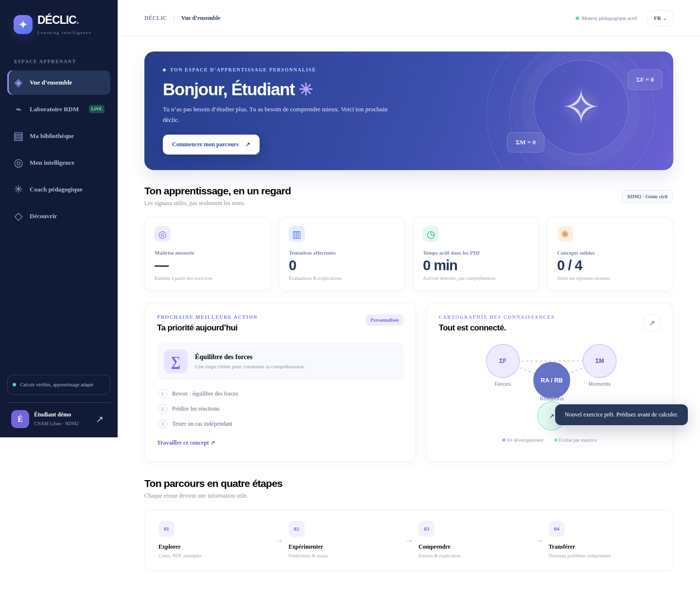

# DÉCLIC · From information to understanding

**AI Educathon 2026 · CNAM Liban · RDM2 (Civil Engineering)**

DÉCLIC is a French-first (English toggle), responsive adaptive-learning proof of concept. Rather than handing out a corrected answer, it connects an engineering exercise to a learner's evolving knowledge profile. It demonstrates one complete **predict → experiment → explain → independent transfer** cycle.



## Run locally

Requirements: **Python 3.10+** and a modern browser. No Node installation, database server, paid AI service, or Docker is required.

```bash
# macOS / Linux
python -m venv .venv
source .venv/bin/activate
pip install -r requirements.txt
python -m uvicorn app.main:app --reload
```

```powershell
# Windows PowerShell
py -m venv .venv
.venv\Scripts\Activate.ps1
pip install -r requirements.txt
python -m uvicorn app.main:app --reload
```

Open **http://127.0.0.1:8000** and choose **Explorer la démo immédiatement**. Alternatively register a local account.

For the PDF reader, upload **`data/demo_rdm2.pdf`** from this repository. No external network or model key is necessary for the principal learning flow. Google Fonts are an optional enhancement; the interface falls back to system fonts offline.

### Optional LLM coach

Copy `.env.example` to `.env` and set `GEMINI_API_KEY` or `OPENROUTER_API_KEY`. The app reads **environment variables**, so load them in the shell before starting (the `.env` file is a template, not auto-loaded):

```bash
export GEMINI_API_KEY="your-key"    # macOS/Linux
# PowerShell: $env:GEMINI_API_KEY = "your-key"
python -m uvicorn app.main:app --reload
```

If no key is provided or the provider fails, the UI transparently switches to **rule-based Socratic guidance**. Live AI is optional; **all numerical results are computed locally**, never trusted to the LLM. Do not commit credentials.

## 4-minute live demonstration

1. **Dashboard** — the initial mastery estimate is intentionally blank; no fabricated scores.
2. **Laboratoire RDM** — set `L=8 m`, `P=12 kN`, `a=2 m`, `q=2 kN/m`, then click **Utiliser cette configuration**.
3. **Predict** — choose `RA = RB` (intentionally incorrect) and observe formative feedback.
4. **Solve** — enter `RA=9`, `RB=3` (deliberately forget the distributed load). The verified answer is `RA=17`, `RB=11`. DÉCLIC identifies the omitted load and shows shear and bending-moment plots.
5. **Explain** — explain force balance, lever arms, and the equilibrium of moments in your own words. The checklist flags missing reasoning cues; it is *not* a semantic proof of correctness.
6. **Transfer** — launch an independent case with different values, then return to the dashboard. The learner profile and next priority change.
7. **PDF tracker** — upload `data/demo_rdm2.pdf`, browse pages and see per-page activity analytics. **Active reading time ≠ understanding.**
8. **Coach & Discover** — use the always-on rule-based coach, optionally enable Gemini/OpenRouter, and see curated MIT, OpenStax and PhET resources.

A timed presenter script is in [`docs/DEMO_SCRIPT_FR.md`](docs/DEMO_SCRIPT_FR.md).

## Implemented

| Feature | Implementation | Important distinction |
|---|---|---|
| F01 authentication | Local registration/login, hashed passwords, bearer sessions, one-click isolated demo | Single-instance prototype; not a university SSO |
| F02–F03 course PDFs | PDF upload, extraction, rendered in-app pages, source excerpts | Text PDFs supported; no OCR of scans |
| F04 learning profile | Per-concept heuristics weighted toward independent transfer | Not a validated psychometric score |
| F05 interactive beam | Load parameters, SVG beam, shear and moment diagrams | One simply supported beam model |
| F06 recurring mistakes | Deterministic classifications; moment arms, omitted UDL, force balance | Heuristic, limited to this model |
| F07 guided learning | Rule-based Socratic tutor, optional external LLM | LLM answers are labeled and may err |
| F08 independent assessment | New parametric case; first attempt immutable | Not a proctored test |
| F09–F11 adaptive priorities | Based on mastery, importance, exam proximity | Explainable rules, not predictive ML |
| F12 resource discovery | Curated reputable links ranked by target concept | No live social/web crawler |
| F13 writing feedback | Transparent textual checklist on student's explanation | Does not establish actual correctness |
| F14 learning signals | Alert after repeated misconception | No predictive academic risk label |
| F16–F20 PDF analytics | Pages viewed, foreground activity, active time | Timer is approximate, not attention tracking |

Not implemented: institutional integrations, teacher dashboard, automated curriculum mapping across arbitrary subjects, verified social-media recommendations, secure production deployment, or measured improvements in educational outcomes. The term **“AI” describes the optional LLM coach and product direction**, not the deterministic parts.

## Verify the code

```bash
python -m pytest -q
```

The test suite checks analytic equilibrium against independent formula values, error classification, user isolation, auth, PDF rendering/text extraction, activity tracking, coaching fallback, and a complete learning cycle. Run `python -m pytest -q` rather than bare `pytest` on environments where the current directory is not added to Python's import path.

## Architecture

```text
Browser (HTML / CSS / vanilla JS, FR/EN)
  ├── Dashboard / learner profile
  ├── SVG RDM2 simulator + charts
  ├── PDF reader with active-time events
  └── Socratic coach + curated resources
                    │ REST + Bearer auth
FastAPI            │
  ├── engine.py     → deterministic statics + explanation checklist
  ├── learning.py   → explainable mastery and priorities
  ├── ai.py         → lexical document retrieval + optional Gemini/OpenRouter
  ├── storage.py    → SQLite, salted PBKDF2 passwords, expiring sessions
  └── main.py       → validation, access control, file processing, API
                    │
               SQLite (local)
```

See [`docs/ARCHITECTURE.md`](docs/ARCHITECTURE.md) for data flow, formulas, model limitations, threat model and deployment recommendations.

## Trust, privacy and ethics

- Every user owns their PDFs, reading events and attempts. Every document/challenge endpoint checks ownership.
- PDFs are stored locally in SQLite, with a 12 MB / 120 page limit. Session tokens expire after 3 days; passwords use salted PBKDF2-HMAC-SHA256.
- Raw uploaded content may be sent **as selected excerpts to Gemini/OpenRouter only if a key is configured and the student invokes the coach**. Do not connect personal/course PDFs to an external LLM without explicit informed consent.
- In this one-day proof of concept, accounts are local, data is **not encrypted at rest**, and there is no operator-managed deletion or consent flow. Do **not** use this build with sensitive real student data or expose it publicly unchanged.
- The learning score is a transparent heuristic, not a grade or academic risk prediction. The explanation checklist uses keywords and can be fooled.
- Citation display indicates *retrieval provenance*, never automatic factual verification. Deterministic engineering results have priority.
- The included beam simulator is for instruction, **not structural design or safety decisions**.

## Foundational references

- [OpenStax, *University Physics* 12.1 — Conditions for Static Equilibrium](https://openstax.org/books/university-physics-volume-1/pages/12-1-conditions-for-static-equilibrium) — equilibrium of forces and torques.
- [MIT OpenCourseWare, *Solid Mechanics 1.050*](https://ocw.mit.edu/courses/1-050-solid-mechanics-fall-2004/) — introductory statics and structural mechanics, including determinate beams.
- [PhET, *Balancing Act*](https://phet.colorado.edu/en/simulations/balancing-act) — interactive torque and lever-arm intuition.

DÉCLIC is an independently developed competition prototype, not endorsed by the institutions above.
